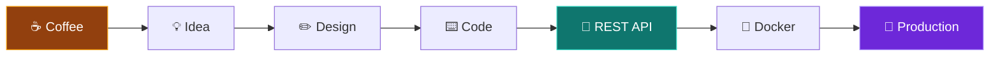

<!-- ============ HEADER BANNER ============ -->
<div align="center">


<a href="https://git.io/typing-svg">
  
</a>

<br/>


<br/><br/>

<a href="https://modernize-portifo.vercel.app/"></a>
<a href="https://www.linkedin.com/in/desiye-dev"></a>
<a href="mailto:desalegnky827@gmail.com"></a>

</div>

---

## 👨‍💻 About Me

<div align="center">


</div>

```js
const desalegn = {
  role: "Software Engineering Intern @ Askuala Link Software Company",
  education: "BSc Computer Science, Bahir Dar University (Class of 2026)",
  location: "Ethiopia 🇪🇹",
  focus: ["Security", "AI", "Microservices", "Docker", "React", "System Design"],
  currentlyLearning: ["Event-driven architecture", "Scalable backend design"],
  funFact: "I turn coffee into REST APIs ☕ → 🔌",
  lookingFor: "Opportunities to build impactful, production-grade software 🚀",

  philosophy() {
    return "Clean, scalable, maintainable. Ship it, then make it better.";
  },

  build(idea) {
    return coffee(idea).design().code().test().containerize().deploy();
  },
};
```

> 💬 *"I love finding practical ways to bring modern technologies together into* ***clean, scalable, and maintainable*** *software."*

<br/>

<div align="center">


<br/>


</div>

<br/>

### 🎯 My Focus Areas

<table align="center">
  <tr>
    <td align="center" width="16%">🔐<br/><b>Security</b><br/><sub>JWT, auth flows,<br/>KYC systems</sub></td>
    <td align="center" width="16%">🤖<br/><b>AI</b><br/><sub>AI-powered<br/>platforms</sub></td>
    <td align="center" width="16%">🧩<br/><b>Microservices</b><br/><sub>Gateway, queues,<br/>service design</sub></td>
    <td align="center" width="16%">🐳<br/><b>Docker</b><br/><sub>Containers &<br/>Compose</sub></td>
    <td align="center" width="16%">⚛️<br/><b>React</b><br/><sub>Modern,<br/>responsive UIs</sub></td>
    <td align="center" width="16%">🏗️<br/><b>System Design</b><br/><sub>Scalable, clean<br/>architecture</sub></td>
  </tr>
</table>

### 🌱 Currently Learning

<div align="center">


</div>

### ☕ How I Work



### 🔭 What I'm Looking For

<div align="center">

| 🚀 Opportunities | 🤝 Collaboration | 📚 Growth |
|:---:|:---:|:---:|
| Build impactful, **production-grade** software | Open-source and team projects | Learn from real-world engineering challenges |

</div>

<div align="center">


</div>

---

## 🛠️ Tech Stack

<div align="center">

**Languages**


**Frontend**


**Backend & Databases**


**DevOps & Tools**


</div>

<details>
<summary><b>📋 Full breakdown</b></summary>

<br/>

| Area | Technologies |
|---|---|
| **Languages** | JavaScript, TypeScript, SQL |
| **Frontend** | React.js, Next.js, Redux Toolkit, React Query, Tailwind CSS |
| **Backend** | Node.js, Express.js, FastAPI, REST APIs, JWT Authentication |
| **Databases** | PostgreSQL, MongoDB, Redis |
| **ORM** | Prisma |
| **DevOps & Docs** | Docker, Docker Compose, GitHub Actions, Swagger/OpenAPI |
| **Tools** | Git, GitHub, Postman, Linux, VS Code, Docker Desktop |

</details>

---

## 🏗️ Featured Projects

<div align="center">


</div>

### 🌐 Websites

<table>
  <!-- ========== MENGED (flagship) ========== -->
  <tr>
    <td colspan="2" valign="top">
      
      <p>
        
        
        
        
      </p>
      <p>
        A transport platform built by a <b>team of three</b> (Desalegn, Esubalew, Getacher) as part of my internship at the Askuala Link GitHub organization.
      </p>
      <p>
        <b>⚙️ 7 Microservices:</b> <code>API Gateway</code> · <code>Auth</code> · <code>Verification</code> · <code>Notification</code> · <code>Payment</code> · <code>Traffic</code> · <code>License</code><br/>
        <b>📱 2 Mobile Apps:</b> Traffic · Driver<br/>
        <b>🖥️ 4 Portals:</b> Admin · Traffic · Driver · Staff
      </p>
      <p>
        
      </p>
      <a href="https://github.com/askualalink/menged_transport"></a>
    </td>
  </tr>

  <!-- ========== DBS + LTTMS ========== -->
  <tr>
    <td width="50%" valign="top">
      
      <p>
        
        
      </p>
      <p>A digital banking platform split into <b>4 microservices</b>: <code>Auth</code>, <code>KYC</code>, <code>User</code> and <code>Notification</code>.</p>
      <p>
        
      </p>
      <a href="https://dbs-demo.onrender.com"></a>
      <a href="https://github.com/Degky827/DBS"></a>
    </td>
    <td width="50%" valign="top">
      
      <p>
        
        
      </p>
      <p>A full-stack management system built on a clean <b>layered backend</b> architecture.</p>
      <p>
        
      </p>
      <a href="https://lttms-98vb.vercel.app/"></a>
      <a href="https://github.com/Degky827/LTTMS"></a>
    </td>
  </tr>

  <!-- ========== PORTFOLIO ========== -->
  <tr>
    <td colspan="2" valign="top">
      
      <p>
        
        
      </p>
      <p>A <b>3D-based full-stack portfolio</b> that showcases my work in an immersive, interactive way.</p>
      <p>
        
      </p>
      <a href="https://modernize-portifo.vercel.app/"></a>
      <a href="https://github.com/Degky827/Portfolio"></a>
    </td>
  </tr>
</table>

### 📱 Apps

<table>
  <tr>
    <!-- DGRL -->
    <td width="33%" valign="top">
      
      <p>A secure app for storing and accessing <b>student grade reports</b> digitally.</p>
      <p></p>
      <a href="https://desiyedgrl.base44.app"></a>
      <a href="https://github.com/Degky827/DGRL"></a>
    </td>
    <!-- ALGO -->
    <td width="33%" valign="top">
      
      <p>A lightweight, educational <b>WebGL</b> app that visualizes sorting, searching and data structures in 3D.</p>
      <p></p>
      <a href="https://degky827.github.io/Algo_App/"></a>
      <a href="https://github.com/Degky827/Algo_App"></a>
    </td>
    <!-- CALCULATOR -->
    <td width="33%" valign="top">
      
      <p>An advanced <b>PWA</b> with binomial theorem calculations and interactive graphing.</p>
      <p></p>
      <a href="https://degky827.github.io/scientific-calculator/"></a>
      <a href="https://github.com/Degky827/scientific-calculator"></a>
    </td>
  </tr>
</table>

---
## 🧭 What I'm Focused On

| 🔭 Now | 🌱 Learning | 🎯 Goal |
|---|---|---|
| Building microservices-based, secure and AI-powered platforms | Docker, system design, message-driven architecture | Graduate and ship production-grade software |

---

## 📊 GitHub Stats

<div align="center">

<!-- Contribution streak -->


<br/><br/>

<!-- Stats + top languages (hosted cards, no GitHub Action needed) -->


<br/><br/>

<!-- Contribution graph -->


</div>

---

## 🤝 Let's Connect

I'm always open to collaborating, learning, and talking about software, architecture, and building cool things.

<div align="center">

<a href="https://modernize-portifo.vercel.app/"></a>
<br/>
<a href="https://www.linkedin.com/in/desiye-dev"></a>
<a href="mailto:desalegnky827@gmail.com"></a>

</div>

<br/>

<div align="center">

*⭐ Always learning, building, and improving through real-world software engineering projects.*


</div>
